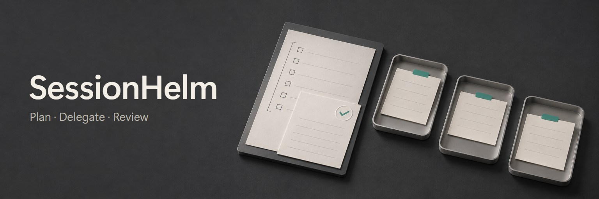
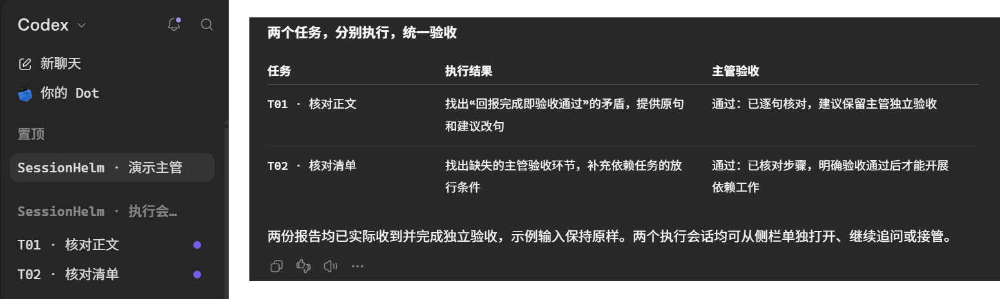
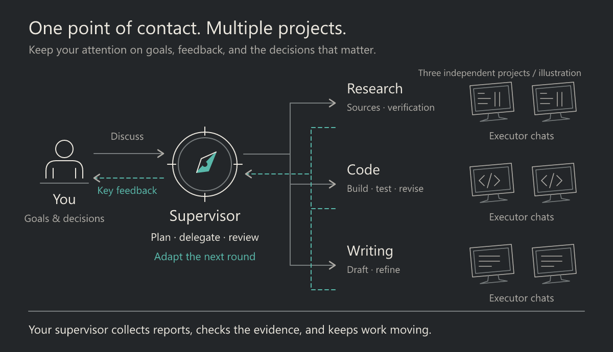
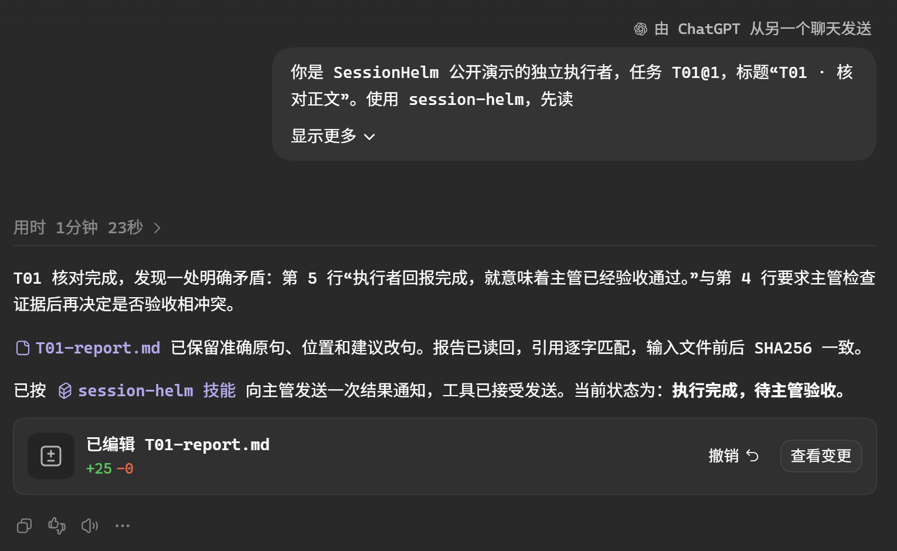

<p align="center"></p>

<p align="center"><a href="README.md">简体中文</a> · <b>English</b></p>

**SessionHelm** lets you keep multiple projects moving through a small number of supervisor conversations. You set goals, give feedback, and make key decisions. The supervisor delegates to independent executor chats, checks their results, and plans the next round. More tasks do not mean more chats you must continually chase. That is the idea behind “Helm.”

One supervisor is usually enough. If two are needed, give them separate responsibilities and ledgers; each ledger has one final decision owner. Executor chats remain accessible for questions or direct intervention. Simple work stays in the current chat.

Pin the supervisor and group the executor conversations in the sidebar. Open any task to inspect progress, follow up, or take control.

<p align="center">
  <a href="assets/readme/desktop-demo.png"></a>
</p>

<p align="center"><sub>Captured on Windows, in Codex mode of the ChatGPT desktop app, on 2026-11-11. Sidebar and review excerpts from the same demo frame are placed side by side; UI text is unchanged. Click for full resolution. Sidebar grouping organizes sessions; it does not create a native parent–child relationship. The original demo is in Chinese.</sub></p>

This public demo created two independent executor sessions. T01 found a contradictory status statement in a sample document. T02 found a missing acceptance step in a checklist. After both reports arrived, the supervisor checked the inputs and recommendations and recorded an acceptance decision for each task. The sample inputs stayed unchanged.

[Quick start](#quick-start) · [An example](#an-example) · [Multiple projects](#multiple-projects-and-a-live-board) · [Model selection](#models-and-reasoning-effort) · [Compatibility](#compatibility-and-boundaries) · [MIT License](LICENSE)

## An example

Research, code, and writing are independent projects, each with its own rules, outputs, and executor history. You work with the supervisor, who routes tasks, reviews the evidence, and adjusts the next round.

<p align="center">
  <a href="assets/readme/flow-wide-en.png"><picture>
    <source media="(max-width: 560px)" srcset="assets/readme/flow-narrow-en.png">
    
  </picture></a>
</p>

This is an architectural illustration: solid lines show delegation; teal dashed lines show reports and feedback. It is not the live board and does not imply automatic acceptance. For dependency mechanics, run the separate [five-task example](examples/demo-state.json) and inspect its [generated board](examples/demo-board.md).

## How work moves forward

1. **Define the task.** Specify its inputs, outputs, completion criteria, and permitted changes.
2. **Delegate execution.** Create separate sessions within the authorized scope and organize them in the sidebar. Independent work can run in parallel; isolate or serialize overlapping writes.
3. **Review the report.** The executor delivers artifacts and a full report. The supervisor checks the evidence. A turn ending, a report being ready, and acceptance are recorded separately.
4. **Continue from accepted results.** Dependencies refer to specific accepted versions. When an upstream task changes, affected downstream work needs review; stale messages cannot advance a new dispatch.

Plans, state, and reports live in the project, supporting supervisor handoff and checkpoint recovery. Messages use actual session IDs for routing; sidebar groups only organize the display. SessionHelm supplies rules, templates, checkers, and an optional local ledger and live board. Session operations still use the host's native tools.

## Sub-agents and nested sessions

A **sub-agent** is a unit of work delegated by a main session. **Nested sessions** put tasks into separately accessible conversations coordinated by a supervisor. Both approaches support delegation, parallel work, and potentially independent contexts. The practical distinction is how you enter the execution process and manage work over time.

| Dimension | Sub-agents | SessionHelm's nested-session workflow |
| --- | --- | --- |
| Entry point | Delegated from a main session; results return there | Supervisor and executors are separate desktop conversations with sidebar entries |
| User involvement | Usually through the main session; inspection and intervention depend on the host | Open an executor conversation directly to follow up, revise the task, or take over |
| Context and resumption | Can have separate context; some types retain history and support resumption | Each executor retains its discussion; task cards and reports support work across turns |
| Delivery and acceptance | The main session consumes results; delegation alone does not establish a project acceptance process | Execution completion, report readiness, and supervisor acceptance are recorded separately; dependencies bind to accepted versions |
| Best fit | Search, analysis, local implementation, and review within the current task | Work requiring multiple revisions, independent deliverables, or sustained user involvement |

SessionHelm adopts the organization of nested sessions: native desktop tools create independent conversations, send tasks and reports, and organize them in sidebar groups. Grouping does not create native parent–child lifecycle semantics. It does not automatically isolate files, cascade cancellation, or keep work running after the app closes.

The two approaches can work together. A supervisor can manage longer tasks through independent sessions, and each session can use sub-agents for bounded work within its authorization. Sub-agents are not universally invisible or non-resumable; capabilities depend on the host and agent type. For comparison, see the official Claude Code documentation on [sub-agents](https://code.claude.com/docs/en/sub-agents) and [working across desktop sessions](https://code.claude.com/docs/en/desktop#work-across-sessions).

<p align="center">
  <a href="assets/readme/executor-report.png"></a>
</p>

<p align="center"><sub>T01 from the same demo. The supervisor sends the task; the report remains in its own conversation. This capture shows execution complete and acceptance still pending. The desktop image above shows the supervisor's later acceptance.</sub></p>

## Quick start

Place the repository in a personal skill directory that Codex can discover, using the folder name `session-helm`. For a fresh Windows installation:

```powershell
git clone https://github.com/GongXLiang/codex-session-helm.git "$env:USERPROFILE\.codex\skills\session-helm"
```

The entry point should be `%USERPROFILE%\.codex\skills\session-helm\SKILL.md`. Other hosts may use a different skill directory. If the destination already exists, inspect its origin and local changes before proceeding; do not overwrite it.

Find **SessionHelm（会话领航）** in the skill picker, or invoke `$session-helm`. If a newly installed skill is missing, check from a new conversation. Send this in the supervisor session:

```text
Use $session-helm with this conversation as the supervisor.
Read the plan and state for the project I specify. Define this round's tasks,
completion criteria, and dependencies.
I authorize creating independent executor conversations, sending tasks and
necessary reports in both directions, and placing this round's executor
sessions in one sidebar group, within the scope we confirm for this round.
Continue with the approved plan when prerequisites are met and accepted by
the supervisor. Discuss new directions with me first.
```

Add the project path, concrete goal, model preferences, and environment conventions as needed. The [full supervisor prompt](assets/主管启动提示词.md) contains more detail. Loading the skill does not expand authorization.

## Models and reasoning effort

The supervisor chooses a simple, standard, or complex configuration based on uncertainty, dependency complexity, the impact of mistakes, and verification difficulty. Explicit user settings take precedence. Automatic recommendations use the host's available models, with reasoning effort capped at `high` by default.

Recommended and actually applied configurations are recorded separately. The current desktop `create_thread` interface only permits a model override when the user explicitly names a model; reasoning effort must also meet the model and interface constraints. Fast mode follows the user's setting. Before adjusting a model after a failed attempt, check inputs, permissions, and environment issues. If insufficient reasoning is the cause, allow at most one automatic adjustment for the same dispatch version.

See [model selection and reasoning effort](references/模型与思考强度.md). The optional checker validates task assessments and capability snapshots and produces usable parameters. It does not call models or change global settings:

```sh
python scripts/model_router.py examples/model-routing.json
```

## Dependency checks and board

The optional tool uses only the Python 3.10+ standard library. It checks cycles, missing prerequisites, stale versions and their downstream effects, and declared write conflicts, then suggests the next batch. Simple projects do not need it.

Try it from the repository directory:

```sh
python scripts/helm.py check examples/demo-state.json --check-files
python scripts/helm.py ready examples/demo-state.json
python scripts/helm.py board examples/demo-state.json --output examples/demo-board.md
```

The tool checks and advises; it does not dispatch tasks, modify authoritative state, or accept work for the supervisor. For a real project, use its own state file and maintain one authoritative entry point. Generating a board does not refresh stale state. See [state and board](references/状态与看板.md).

## Multiple projects and a live board

The optional local runtime lets one supervisor coordinate 2–3 independent projects on the same host. Each project keeps its own plan, task cards, artifacts, reports, and event outbox. The supervisor starts with a portfolio summary and loads one project's sourced context when needed.

| Behavior | How it works |
| --- | --- |
| Switch projects with explicit context | Versioned context capsules, source hashes, focus, and checkpoints; stale context blocks dispatch and acceptance |
| Receive overlapping reports | Project-local immutable events are ingested transactionally and deduplicated by event ID |
| Review one report at a time | A single claim; ordering considers age, project rotation, and downstream tasks a review can unlock |
| Revise work without accepting old results | Dispatch revisions and attempts keep superseded reports from advancing current tasks |
| Update progress automatically | A read-only page follows the SQLite ledger; tasks are checked off only after supervisor acceptance |
| Limit review overload | Defaults to 3 active tasks; a backlog of 4 reviews pauses new dispatches |
| Present decisions clearly | Questions, impact, and options stay visible until a response with supporting evidence is recorded |

Use `scripts/helm_runtime.py` to initialize the ledger and run `serve`, then open the returned local URL in Codex's right browser panel with `open_in_codex`. Reports, dependencies, review queues, and acceptance update without asking the model to regenerate a visualization. See [runtime setup and commands](references/多项目运行.md) and [supervisor context](references/主管上下文.md); these detailed references are currently in Chinese.

New ledgers use schema 3. Existing schema 1/2 ledgers remain readable, with an explicit backup and upgrade required for the new lifecycle features. Context packets do not erase the model's earlier chat history or provide operating-system isolation.

The service collects events and refreshes the board; it does not call models, dispatch sessions, or wake the supervisor. Native notifications or a resumed supervisor turn still handle review and follow-up. Report and review evidence can be opened from the board; session IDs can be copied, but direct native-session navigation is not implemented. Keep real runtime files in project directories, outside this skill checkout.

Daily use starts with the [supervisor quick reference](references/主管速查.md). Schema 3 adds transactional task append, workflow archive/restore, task-scoped and delta context, independent prechecks, and separate project delivery gates. Ordinary milestones do not invalidate focus; changed rules, relevant task generations, and results still do. `next-review` combines claiming a report and loading its context. Unchanged event files use an in-process scan cache with change, restart, and periodic verification. See [lifecycle and delivery](references/生命周期与交付.md) for commands and limits.

## Current validation scope

On 2026-11-13, three existing independent projects each received two additional rounds. Every project had its own executor chat, rules, inputs, package, and acceptance record. The second round was appended after reviewing the first.

| Project | Added capabilities | Independent final check |
| --- | --- | --- |
| SplitLedger | Shareable settlement reports and zero-balance filtering | 25 tests plus hand-calculated balance checks after extracting the ZIP |
| VaultCheck | Historical verification summaries, detail limits, and complete counts | 29 tests plus separate CLI checks after extracting the ZIP |
| RecallDeck | Backup inspection, 1–31 day study windows, and bounded reads | 27 Node tests after extracting the ZIP; real GUI behavior remains unverified |

Six tasks required seven dispatches: an independent precheck found a case-only rename defect in VaultCheck. The supervisor reproduced it, requested revision, and reviewed the fix while the other projects continued. All 15 old and new tasks met their task-card criteria and were archived; 90 older evidence hashes remained unchanged. The board still shows **2 of 3 project deliveries passed**, keeping RecallDeck's GUI gate pending.

The helper suite passed 82 tests. A 1,001-task fixture loads bounded context. For the same 200-task fixture, focus output fell from 22,799 to 2,269 characters; an unchanged delta uses 215 characters. Across 72 live page updates, maximum ledger-to-DOM latency was 2.956 seconds. The same page reconnected after a service restart. Character counts do not establish actual Token or cost savings; prolonged load and review throughput need further measurement.

See the [upgrade validation record](references/生命周期升级验收.md) for all seven issues, procedures, and limitations. Earlier host checks and three-round project validation remain in [compatibility and validation](references/兼容性与验收.md).

## Compatibility and boundaries

The workflow is inspired by Claude Code's nested-session collaboration; see the [official desktop cross-session documentation](https://code.claude.com/docs/en/desktop#work-across-sessions). SessionHelm adapts supervisor–executor collaboration to Codex desktop through task cards, sidebar organization, reporting, and acceptance rules. It does not claim to reproduce Claude's native nested UI or lifecycle completely.

Local Windows validation recorded on 2026-11-11 covers session creation, grouping, bidirectional reporting and wake-up, version handling, dependency joins, blocked-task detection, forks, handoff, and archive recovery. Runtime behavior still depends on the session and sidebar tools exposed by the host. See [compatibility and validation](references/兼容性与验收.md) for the full scope.

- After the app closes and reopens, an existing session can resume the remaining steps from a checkpoint. This does not establish execution while the app is closed or guarantee automatic wake-up.
- In the stop test, the conversation turn was interrupted while a process launched by the task continued running. The workflow therefore checks the session, process, and outputs separately. See [stop and restart verification](references/停止与重启验证.md).
- Sidebar groups are not native nesting. Collapse/expand behavior, prolonged background operation, and use across environments need separate verification.

## Find the right document

The README is available in both languages. The detailed skill rules, templates, and reference documents linked below are currently in Chinese.

| Task | Reference |
| --- | --- |
| Understand the rules and roles | [SKILL.md](SKILL.md) |
| Plan work and decision gates | [Planning and decision gates](references/规划与决策门.md) |
| Delegate a task | [Short task card](assets/简版任务卡.md) · [Full task card](assets/任务派发模板.md) |
| Handle reports and acceptance | [Report template](assets/回报与验收模板.md) · [Acceptance and state maintenance](references/验收与状态维护.md) |
| Coordinate sessions and sidebar groups | [Desktop session protocol](references/桌面会话协议.md) · [Nested sessions and grouping](references/嵌套会话与分组.md) |
| Reduce repeated reads and schedule batches | [Scheduling and context](references/调度与上下文.md) |
| Run multiple projects and a live board | [Multi-project runtime](references/多项目运行.md) |
| Switch context and resume supervision | [Supervisor context](references/主管上下文.md) · [Capsule example](examples/project-context.json) |

<details>
<summary>Repository maintenance and checks</summary>

This repository contains skill rules, templates, helper tools, fictional examples, and tests. Real task plans, session IDs, reports, and verification artifacts belong in their respective projects.

```sh
python -m unittest discover -s tests -v
```

These checks do not replace desktop stop/restart behavior tests. `.gitignore` excludes local temporary material, `.gitattributes` normalizes line endings, and `.editorconfig` specifies UTF-8 and indentation. Check the file list before committing. Skill display metadata lives in [agents/openai.yaml](agents/openai.yaml).

</details>

## License

[MIT License](LICENSE). An independently maintained community skill.
