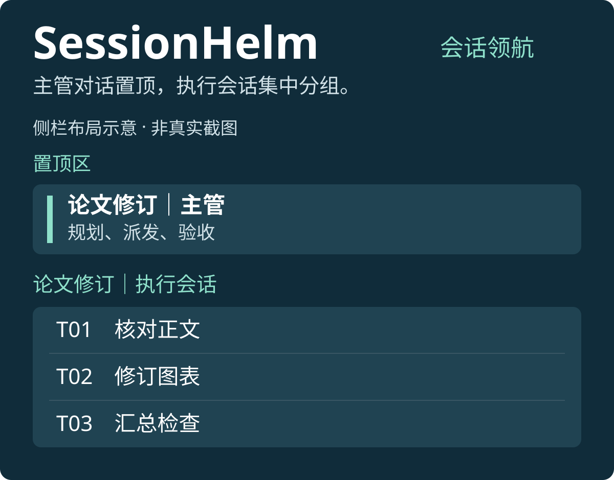
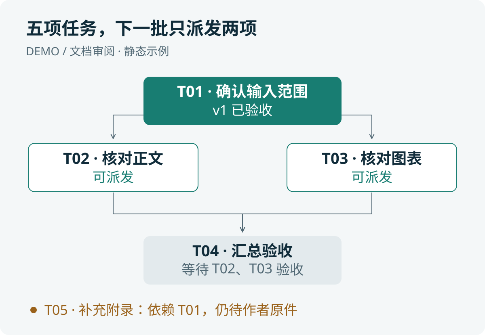

# SessionHelm（会话领航）

<p align="center">
  
</p>

**Plan, delegate, and review across Codex desktop sessions.**

SessionHelm 为 Codex 桌面多会话协作提供一套工作规则：主管规划、派发并独立验收，执行者在可单独查看和接管的对话中完成任务。适合研究、写作、绘图和代码项目；简单工作仍留在当前会话。

把主管对话置顶，执行对话集中分组；随时打开某项任务，查看进度或直接接管。上图是侧栏布局示意，分组不表示原生父子关系或自动折叠。

设计灵感来自 Claude Code 的嵌套会话（nested sessions）协作思路，相关背景可参阅[官方桌面跨会话文档](https://code.claude.com/docs/en/desktop#work-across-sessions)。SessionHelm 在 Codex 桌面中借鉴这种主管与独立执行会话的协作方式，落实为任务卡、侧栏组织、回报和验收规则；不宣称完整复刻 Claude 的原生嵌套界面或生命周期。

[快速开始](#快速开始) · [看一个例子](#看一个例子) · [模型选择](#模型与思考强度) · [使用边界](#兼容性与边界) · [MIT License](LICENSE)

## 看一个例子

一次文档审阅有五项任务。输入范围通过验收后，正文和图表可以并行核对；汇总必须等两项都验收通过。缺少原件的附录继续等待，不阻塞其他独立工作。

<p align="center">
  
</p>

这张图来自仓库的[虚构示例状态](examples/demo-state.json)，与[检查器生成的看板](examples/demo-board.md)一致，是静态说明。当前看板输出为 Markdown 表格和 Mermaid 依赖图，尚未接入 Visualize 自动刷新。

## 协作怎样推进

1. **先明确任务。** 为每项工作写清输入、输出、完成标准与允许修改的范围。
2. **再派发执行。** 在授权范围内创建独立会话，用侧栏分组组织；独立任务可并行，重叠写入先隔离或串行。
3. **回报后验收。** 执行者提交产物和完整报告，主管检查证据；回合结束、报告就绪、验收通过分别记录。
4. **依据有效结果继续。** 依赖绑定具体的已验收版本。上游改版后，受影响的下游需要复核，旧消息不能推进新任务。

计划、状态和报告保存在项目中，支持主管交接与检查点恢复。消息按真实会话 ID 路由，侧栏分组只负责显示组织。SessionHelm 提供规则、模板和可选检查器，通过宿主原生工具执行，不附带编排服务器。

## 与子代理怎样分工

独立执行会话的优势在于便于用户持续跟进：每项任务都有侧栏入口和自己的对话记录，可以单独继续、多轮返工，也可以由你直接接管。主管置顶、执行者集中分组后，长期项目更容易按任务查找进展与交付物。

| 工作场景 | 建议方式 |
| --- | --- |
| 长期工作、多轮修订、独立交付，需要随时打开或接管 | 独立执行会话，由主管统一验收与衔接 |
| 当前主管回合内的短期并行检索、局部分析或复核 | 子代理，在已授权范围内协助主管 |

两种方式可以配合使用。具体上下文保留、恢复与可见性取决于宿主能力；这里比较的是本项目的组织方式与使用场景。

## 快速开始

将仓库放入 Codex 能发现的个人 Skill 目录，文件夹命名为 `session-helm`。Windows 全新安装示例：

```powershell
git clone https://github.com/GongXLiang/codex-session-helm.git "$env:USERPROFILE\.codex\skills\session-helm"
```

安装后的入口应为 `%USERPROFILE%\.codex\skills\session-helm\SKILL.md`。其他宿主以实际技能目录为准；目标目录已有内容时先检查来源和本地修改，不覆盖安装。

在技能选择器中找到 **SessionHelm（会话领航）**，或调用 `$session-helm`。未发现新安装的技能时，用新的对话检查。在主管会话中发送：

```text
请使用 $session-helm，当前对话作为主管。
读取我指定项目的计划与状态，明确本轮任务、完成标准和依赖关系。
我授权在本轮确认的范围内创建独立执行对话、发送任务和必要的双向回报，
并将本轮执行会话放入同一侧栏分组。
已批准计划中的前置条件满足且通过主管验收后可以继续；新方向先与我讨论。
```

按需补充项目路径、具体目标、模型和环境约定；完整版本见[主管启动提示词](assets/主管启动提示词.md)。加载技能本身不扩大操作权限。

## 模型与思考强度

主管根据任务的不确定性、依赖复杂度、出错影响和验证难度，选择简单、常规或复杂配置。用户明确指定的设置优先；自动选择从当前宿主的可用模型中匹配，思考强度默认不超过 `high`。

推荐配置与实际应用分别记录。当前桌面 `create_thread` 仅允许用户明确指定具体模型时覆盖默认模型；思考强度也须符合实际模型及接口限制。Fast 沿用用户设置。返工先排除输入、权限和环境问题，确有推理不足时，同一派发版本最多自动调整一次。

规则和示例见[模型与思考强度](references/模型与思考强度.md)。可选检查器验证任务评估与能力快照，生成可传参数，不调用模型或修改全局设置：

```sh
python scripts/model_router.py examples/model-routing.json
```

## 依赖检查与看板

可选工具使用 Python 3.10+ 标准库，无需额外依赖。它检查循环、缺失前置、旧版本及传递影响、声明写入冲突，并建议下一批任务。已有状态足够简单时，无需启用工具。

在仓库目录试运行：

```sh
python scripts/helm.py check examples/demo-state.json --check-files
python scripts/helm.py ready examples/demo-state.json
python scripts/helm.py board examples/demo-state.json --output examples/demo-board.md
```

工具只提供检查与建议，不派发任务、不修改权威状态、不替主管验收。实际使用时换成项目自己的状态文件，只维护一个权威入口；生成看板不会让旧状态自动变新。详见[状态与看板](references/状态与看板.md)。

## 兼容性与边界

2026-11-11 的 Windows 本地验收记录覆盖会话创建、分组、双向回报与唤醒、版本处理、依赖汇合、阻塞识别、fork、交接及归档恢复。运行仍取决于宿主实际开放的会话和侧栏工具。完整范围见[兼容性与验收](references/兼容性与验收.md)。

- 应用退出重开后，原会话可按检查点只执行剩余步骤；这不代表关闭期间持续运行或保证自动唤醒。
- 停止测试中，对话回合已中断，但任务启动的进程仍在运行。流程因此分别核对会话、进程与输出，见[停止与重启验证](references/停止与重启验证.md)。
- 侧栏分组不构成原生嵌套关系；折叠与展开、长期后台及跨环境运行仍需单独验证。

## 按任务查文档

| 你要做什么 | 入口 |
| --- | --- |
| 理解完整规则与角色 | [SKILL.md](SKILL.md) |
| 制订计划与决策条件 | [规划与决策门](references/规划与决策门.md) |
| 派发一项工作 | [简版任务卡](assets/简版任务卡.md) · [完整任务卡](assets/任务派发模板.md) |
| 处理回报与验收 | [回报模板](assets/回报与验收模板.md) · [验收与状态维护](references/验收与状态维护.md) |
| 协调会话与侧栏分组 | [桌面会话协议](references/桌面会话协议.md) · [嵌套会话与分组](references/嵌套会话与分组.md) |
| 减少重复读取、安排批次 | [调度与上下文](references/调度与上下文.md) |

<details>
<summary>仓库维护与检查</summary>

本仓库只管理技能规则、模板、辅助工具、虚构示例与测试。真实任务计划、会话 ID、报告和验证产物留在对应项目中。

```sh
python -m unittest discover -s tests -v
```

这些检查不能代替桌面停止和重启的行为实测。`.gitignore` 排除本机临时材料，`.gitattributes` 统一文本换行，`.editorconfig` 约定 UTF-8 和缩进；提交前核对文件清单。技能显示信息位于 [agents/openai.yaml](agents/openai.yaml)。

</details>

## 许可证

[MIT License](LICENSE)。独立维护的社区 Skill 项目。
