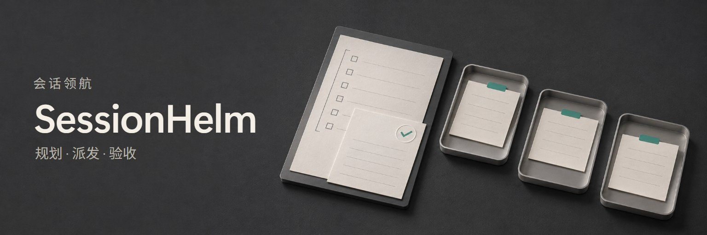
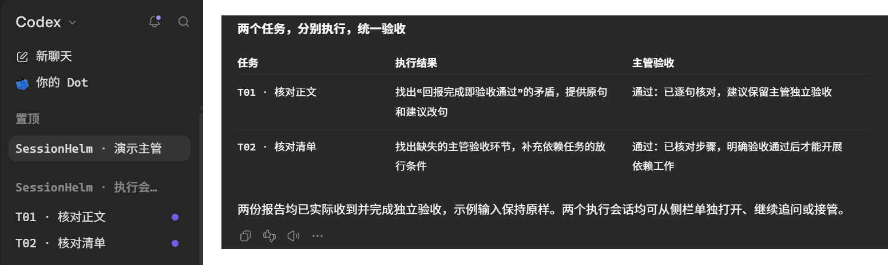
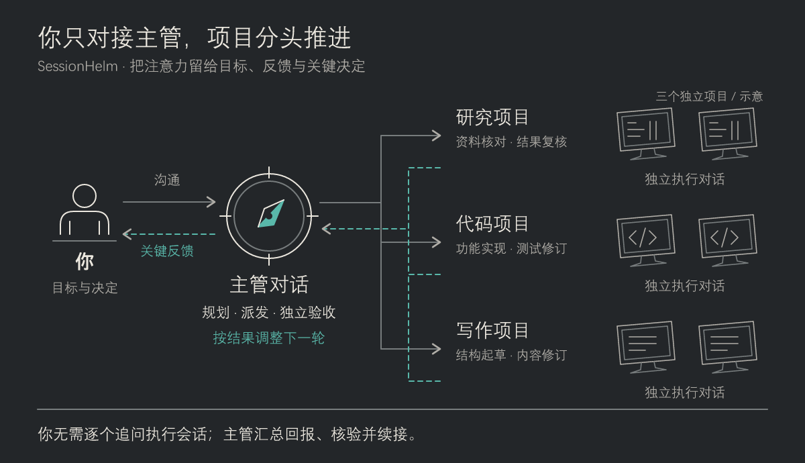
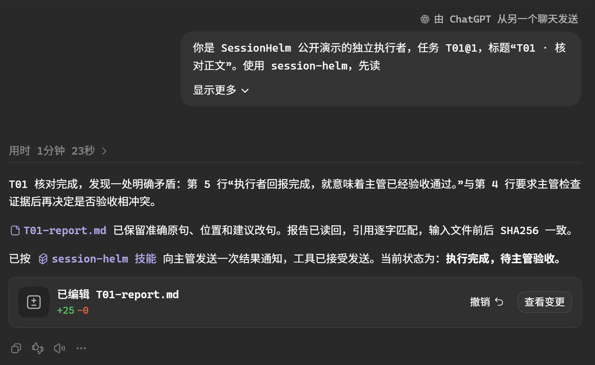

<p align="center"></p>

<p align="center"><b>简体中文</b> · <a href="README.en.md">English</a></p>

**SessionHelm（会话领航）** 为 Codex 桌面多会话协作提供一套工作规则：主管规划、派发并独立验收，执行者在可单独查看和接管的对话中完成任务。适合研究、写作、绘图和代码项目；简单工作仍留在当前会话。

把主管对话置顶，执行对话集中分组；随时打开某项任务，查看进度、继续追问或直接接管。

<p align="center">
  <a href="assets/readme/desktop-demo.png"></a>
</p>

<p align="center"><sub>Windows · ChatGPT 桌面端 Codex 模式 · 2026-11-11 实拍。侧栏与验收回报为同次演示的局部截图并排，界面文字未改写；点击可查看原尺寸。侧栏分组用于组织会话，不代表原生嵌套。</sub></p>

这次公开演示实际创建了两个独立执行会话：T01 找出示例正文中的状态矛盾，T02 找出清单中遗漏的验收步骤。两份报告返回后，主管逐项核对输入与建议，分别记录验收结论；示例输入保持原样。

[快速开始](#快速开始) · [看一个例子](#看一个例子) · [多项目与自动看板](#同时管理多个项目) · [模型选择](#模型与思考强度) · [使用边界](#兼容性与边界) · [MIT License](LICENSE)

## 看一个例子

下面是另一组五项任务的静态示例，用来说明依赖关系：输入范围通过验收后，正文和图表可以并行核对；汇总必须等两项都验收通过。缺少原件的附录继续等待，不阻塞其他独立工作。

<p align="center">
  <a href="assets/readme/flow-wide-zh.png"><picture>
    <source media="(max-width: 560px)" srcset="assets/readme/flow-narrow-zh.png">
    
  </picture></a>
</p>

插图依据[虚构示例状态](examples/demo-state.json)绘制，与 `helm.py board` 生成的[完整看板](examples/demo-board.md)及可派发检查一致。实线表示上游已验收，虚线表示仍待上游验收；T05 的前置虽已满足，但仍缺作者原件。这是静态示例，不随会话刷新；工具实际输出仍为 Markdown 表格和 Mermaid。

## 协作怎样推进

1. **先明确任务。** 为每项工作写清输入、输出、完成标准与允许修改的范围。
2. **再派发执行。** 在授权范围内创建独立会话，用侧栏分组组织；独立任务可并行，重叠写入先隔离或串行。
3. **回报后验收。** 执行者提交产物和完整报告，主管检查证据；回合结束、报告就绪、验收通过分别记录。
4. **依据有效结果继续。** 依赖绑定具体的已验收版本。上游改版后，受影响的下游需要复核，旧消息不能推进新任务。

计划、状态和报告保存在项目中，支持主管交接与检查点恢复。消息按真实会话 ID 路由，侧栏分组只负责显示组织。SessionHelm 提供规则、模板、检查器和可选本地账本/看板；会话操作仍通过宿主原生工具执行。

## 子代理与嵌套会话有什么区别

子代理（sub-agents）是主会话委派出去的工作单元；嵌套会话（nested sessions）把具体任务放进可独立访问的会话，由主管统筹。两者都能分工、并行处理任务，也都可能拥有独立上下文；关键区别在于用户如何进入执行过程，以及任务如何持续管理。

| 对比维度 | 子代理（sub-agents） | SessionHelm 的嵌套式会话工作流 |
| --- | --- | --- |
| 工作入口 | 从主会话发起委派，结果回到主会话 | 主管与执行者都是独立桌面对话，执行者有侧栏入口 |
| 用户参与 | 通常经主会话查看结果；检查、干预能力取决于宿主 | 用户可直接打开执行会话，追问、修订或接管 |
| 上下文与续接 | 可有独立上下文；部分类型支持保留历史并续接 | 执行会话保留自己的讨论，任务卡和报告支持跨回合推进 |
| 交付与验收 | 主会话消费委派结果；不自动提供项目级验收流程 | 分别记录执行完成、报告就绪和主管验收，依赖绑定已验收版本 |
| 适合的工作 | 当前任务中的检索、分析、局部实现与复核 | 多轮修订、独立交付、需要用户持续跟进的长期任务 |

SessionHelm 借鉴 nested sessions 的组织方式，通过桌面原生工具创建独立会话、发送任务与回报，再用侧栏分组组织它们。它不把分组变成宿主原生父子关系，也不自动提供文件隔离、级联停止或退出后持续运行。

两种方式可以配合使用：主管用独立会话管理长期任务，每个会话再在授权范围内使用子代理处理局部工作。子代理并非都不可续接，也并非都对用户不可见；实际能力以宿主和代理类型为准。相关概念可对照 Claude Code 官方的[子代理说明](https://code.claude.com/docs/en/sub-agents)和[桌面跨会话协作](https://code.claude.com/docs/en/desktop#work-across-sessions)。

<p align="center">
  <a href="assets/readme/executor-report.png"></a>
</p>

<p align="center"><sub>同次演示中的 T01 执行会话局部：任务从主管发来，报告留在独立会话中。这张回报记录的是执行完成时的状态；上方桌面截图展示后续主管验收。</sub></p>

## 快速开始

将仓库放入 Codex 能发现的个人 Skill 目录，文件夹命名为 `session-helm`。Windows 全新安装示例：

```powershell
git clone https://github.com/GongXLiang/codex-session-helm.git "$env:USERPROFILE\.codex\skills\session-helm"
```

安装后的入口应为 `%USERPROFILE%\.codex\skills\session-helm\SKILL.md`。其他宿主以实际技能目录为准；目标目录已有内容时先检查来源和本地修改，不覆盖安装。

在技能选择器中找到 **SessionHelm（会话领航）**，或调用 `$session-helm`。未发现新安装的技能时，用新的对话检查。在主管会话中发送：

```text
请使用 $session-helm，当前对话作为主管。
读取我指定项目的计划与状态，明确本轮任务、完成标准和依赖关系。
我授权在本轮确认的范围内创建独立执行对话、发送任务和必要的双向回报，
并将本轮执行会话放入同一侧栏分组。
已批准计划中的前置条件满足且通过主管验收后可以继续；新方向先与我讨论。
```

按需补充项目路径、具体目标、模型和环境约定；完整版本见[主管启动提示词](assets/主管启动提示词.md)。加载技能本身不扩大操作权限。

## 模型与思考强度

主管根据任务的不确定性、依赖复杂度、出错影响和验证难度，选择简单、常规或复杂配置。用户明确指定的设置优先；自动选择从当前宿主的可用模型中匹配，思考强度默认不超过 `high`。

推荐配置与实际应用分别记录。当前桌面 `create_thread` 仅允许用户明确指定具体模型时覆盖默认模型；思考强度也须符合实际模型及接口限制。Fast 沿用用户设置。返工先排除输入、权限和环境问题，确有推理不足时，同一派发版本最多自动调整一次。

规则和示例见[模型与思考强度](references/模型与思考强度.md)。可选检查器验证任务评估与能力快照，生成可传参数，不调用模型或修改全局设置：

```sh
python scripts/model_router.py examples/model-routing.json
```

## 依赖检查与看板

可选工具使用 Python 3.10+ 标准库，无需额外依赖。它检查循环、缺失前置、旧版本及传递影响、声明写入冲突，并建议下一批任务。已有状态足够简单时，无需启用工具。

在仓库目录试运行：

```sh
python scripts/helm.py check examples/demo-state.json --check-files
python scripts/helm.py ready examples/demo-state.json
python scripts/helm.py board examples/demo-state.json --output examples/demo-board.md
```

工具只提供检查与建议，不派发任务、不修改权威状态、不替主管验收。实际使用时换成项目自己的状态文件，只维护一个权威入口；生成看板不会让旧状态自动变新。详见[状态与看板](references/状态与看板.md)。

## 同时管理多个项目

启用可选运行模式后，一个主管可以管理同宿主上 2–3 个独立项目。项目各有任务卡、输入、产物和报告；主管只常驻摘要，审查时按需读取单个项目，减少上下文串线。

| 你看到的行为 | 实现方式 |
| --- | --- |
| 主管切换项目时不凭印象续接 | 全局只读 portfolio；项目使用带来源摘要、focus 和切换检查点，过期版本阻止派发和裁决 |
| 多个执行者同时回报 | 各项目写入独立 outbox，事务入队并按事件ID去重 |
| 主管逐份审查 | 单份领取；按超时、项目轮换、后续任务解锁数排序，核对产物与版本后独立裁决 |
| 返工与中途改版 | 新版本和 attempt 重新派发，旧报告不能覆盖当前状态 |
| 自动勾选与进度更新 | 只读页面订阅同一 SQLite 账本；只有主管验收通过才显示勾选 |
| 任务太多时减速 | 默认并行 3 项，待审查达到 4 项时暂停新派发 |
| 需要你决定时说明缘由 | 看板列出问题、影响和具体选项；记录真实答复依据后才释放对应任务 |

运行 `scripts/helm_runtime.py` 初始化项目账本，并启动 `serve`，再用 `open_in_codex` 在右侧打开实际本地 URL。面板会自动显示新回报、审查队列、依赖和验收变化，用户不必要求模型重画 Visualize。启动、发布与验收的完整命令见[多项目运行](references/多项目运行.md)。

主管上下文的命令和恢复方式见[主管上下文](references/主管上下文.md)。新账本启用 schema 2；旧账本保留可读，需显式备份升级后启用新增门禁。项目摘要和检查点不清空模型已有聊天历史。

本地服务不调用模型，也不会自行唤醒主管。服务运行时可持续收取回报和更新看板；审查与后续派发依靠获授权的原生通知或主管续接。看板可打开当前报告和验收证据，会话入口目前为复制 ID，不能从普通网页直接调用原生导航工具。运行文件保存在项目内，Skill 仓库只保留代码与示例。

## 当前验证范围

2026-11-12 的多项目验收使用三个独立目录和执行会话，每个项目都有初版、反馈修订与独立交付阶段：

| 项目 | 独立用途 | 本机验证结果 |
| --- | --- | --- |
| SplitLedger | 整数分费用分摊与 CSV 输出 | 最终 ZIP 解压后 18 项测试及独立金额核对通过 |
| VaultCheck | SHA-256 归档核验 | 最终 ZIP 解压后 20 项测试及独立 CLI 检查通过 |
| RecallDeck | 离线学习卡片与备份导入 | 20 项核心及模拟交互测试通过；真实 GUI 尚未验证 |

主管上下文切换、交错回报去重、审查积压限流和新主管接手续作均有现场验证。自动看板记录了 119 个在线变化样本，账本入库到 DOM 呈现的最大延迟为 1.022 秒；看板服务重启后，同一页面自动重连。已安装版本的 72 项辅助工具测试通过。这些结果来自一次本地 Windows 验收，不代表所有宿主或长期负载。

RecallDeck 的界面检查受到 file:// 自动化访问限制，后续任务明确限定为核心验收。因此，任务卡全部打勾不等于三个应用的完整验收全部通过。一次原生回告被审批拒绝后，主管通过持久队列恢复结果；自动看板不保证自动唤醒。详细条件与保留的缺口见[综合验收记录](references/兼容性与验收.md#7-schema-2-与三个独立项目的多轮验收)。目前没有对照测量证明节省了多少 Token 或审查时间。

## 兼容性与边界

设计灵感来自 Claude Code 的嵌套会话（nested sessions）协作思路，相关背景可参阅[官方桌面跨会话文档](https://code.claude.com/docs/en/desktop#work-across-sessions)。SessionHelm 在 Codex 桌面中借鉴这种主管与独立执行会话的协作方式，落实为任务卡、侧栏组织、回报和验收规则；不宣称完整复刻 Claude 的原生嵌套界面或生命周期。

2026-11-11 的 Windows 本地验收记录覆盖会话创建、分组、双向回报与唤醒、版本处理、依赖汇合、阻塞识别、fork、交接及归档恢复。运行仍取决于宿主实际开放的会话和侧栏工具。完整范围见[兼容性与验收](references/兼容性与验收.md)。

- 应用退出重开后，原会话可按检查点只执行剩余步骤；这不代表关闭期间持续运行或保证自动唤醒。
- 停止测试中，对话回合已中断，但任务启动的进程仍在运行。流程因此分别核对会话、进程与输出，见[停止与重启验证](references/停止与重启验证.md)。
- 侧栏分组不构成原生嵌套关系；折叠与展开、长期后台及跨环境运行仍需单独验证。

## 按任务查文档

| 你要做什么 | 入口 |
| --- | --- |
| 理解完整规则与角色 | [SKILL.md](SKILL.md) |
| 制订计划与决策条件 | [规划与决策门](references/规划与决策门.md) |
| 派发一项工作 | [简版任务卡](assets/简版任务卡.md) · [完整任务卡](assets/任务派发模板.md) |
| 处理回报与验收 | [回报模板](assets/回报与验收模板.md) · [验收与状态维护](references/验收与状态维护.md) |
| 协调会话与侧栏分组 | [桌面会话协议](references/桌面会话协议.md) · [嵌套会话与分组](references/嵌套会话与分组.md) |
| 减少重复读取、安排批次 | [调度与上下文](references/调度与上下文.md) |
| 多项目运行、队列与自动看板 | [多项目运行](references/多项目运行.md) |
| 切换项目、更新摘要与交接恢复 | [主管上下文](references/主管上下文.md) · [摘要示例](examples/project-context.json) |

<details>
<summary>仓库维护与检查</summary>

本仓库只管理技能规则、模板、辅助工具、虚构示例与测试。真实任务计划、会话 ID、报告和验证产物留在对应项目中。

```sh
python -m unittest discover -s tests -v
```

这些检查不能代替桌面停止和重启的行为实测。`.gitignore` 排除本机临时材料，`.gitattributes` 统一文本换行，`.editorconfig` 约定 UTF-8 和缩进；提交前核对文件清单。技能显示信息位于 [agents/openai.yaml](agents/openai.yaml)。

</details>

## 许可证

[MIT License](LICENSE)。独立维护的社区 Skill 项目。
