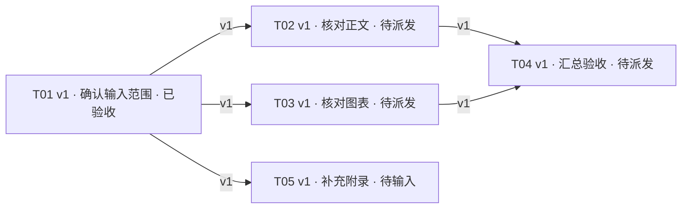

# SessionHelm · demo-document-review

状态时间：2026-11-11T12:00:00+09:00。本页为派生视图，请在权威状态中更新事实。

有效验收 1/5 · 运行中 0 · 待复核 0

下一批建议：T02、T03。

| 任务 | 当前版本 | 任务状态 | 宿主状态 | 依赖版本 | 下一动作或阻塞 |
| --- | --- | --- | --- | --- | --- |
| T01 · 确认输入范围 | 1 | 已验收 | idle | — | 已验收 |
| T02 · 核对正文 | 1 | 待派发 | unknown | T01@1 | 本批可派发；仍需核对现场状态和授权 |
| T03 · 核对图表 | 1 | 待派发 | unknown | T01@1 | 本批可派发；仍需核对现场状态和授权 |
| T04 · 汇总验收 | 1 | 待派发 | unknown | T02@1, T03@1 | 前置任务尚未全部验收 |
| T05 · 补充附录 | 1 | 待输入 | unknown | T01@1 | 等待作者提供附录原件 |

证据入口：
- T01：报告 demo-evidence.md；验收 demo-evidence.md
